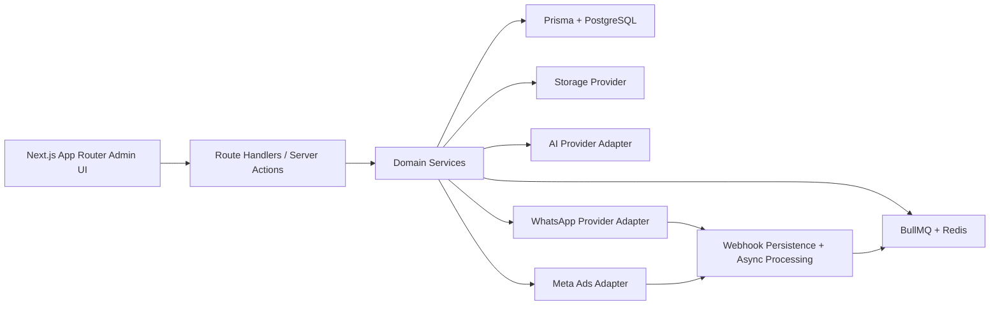
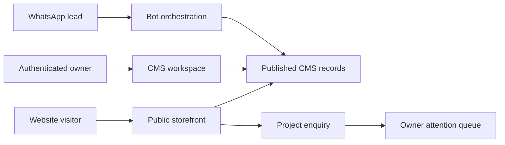

# Architecture Assessment

## Current repository state

The repository was effectively empty. There was no existing application code, no Git history in the workspace root, and no reusable domain implementation. The only reusable asset was the generated Next.js baseline scaffold created for this phase.

## Target architecture

This MVP is being implemented as a modular monolith with clear boundaries so it can evolve into multi-tenant SaaS later without a rewrite.



## Public website and CMS extension

The public site and owner portal remain one modular Next.js application. Public routes read only published CMS records. The protected `/dashboard/cms` workspace writes draft and published content through server actions. Project enquiries enter the owner attention queue. The WhatsApp bot queries the same CMS service used by the storefront, so product and package answers share one controlled source of truth.



## Reusable starter code

- App Router scaffold in `src/app`
- TypeScript configuration
- Tailwind v4 baseline
- ESLint configuration

## Proposed folder structure

```text
src/
  app/
    (app)/
    api/
    login/
  components/
    dashboard/
    forms/
    layout/
    ui/
  config/
  lib/
  modules/
    analytics/
    audit/
    auth/
    bot/
    broadcasts/
    conversations/
    customers/
    dashboard/
    integrations/
    knowledge-base/
    leads/
    meta-ads/
    payments/
    plans/
    settings/
    subscriptions/
  server/
    db/
    jobs/
    queue/
    storage/
    webhooks/
  types/
  tests/
prisma/
worker/
docs/
```

## Phase 1 implementation decisions

- Use Auth.js credentials auth for the seeded single-owner workflow.
- Use Prisma with PostgreSQL decimals and enums for normalized core models.
- Use BullMQ with Redis queues, but keep worker runtime decoupled from web handlers.
- Use mock integration adapters selected by `INTEGRATION_MODE`.
- Build operational dashboard pages from database-backed server components, not hard-coded placeholder cards.
- Keep live integrations behind interfaces so mock mode remains first-class.

## External prerequisites

- PostgreSQL and Redis available locally through Docker Compose.
- Live WhatsApp Cloud API credentials.
- Live Meta Marketing API credentials.
- AI provider credentials for production bot features.
- Encryption key for sensitive integration settings.
